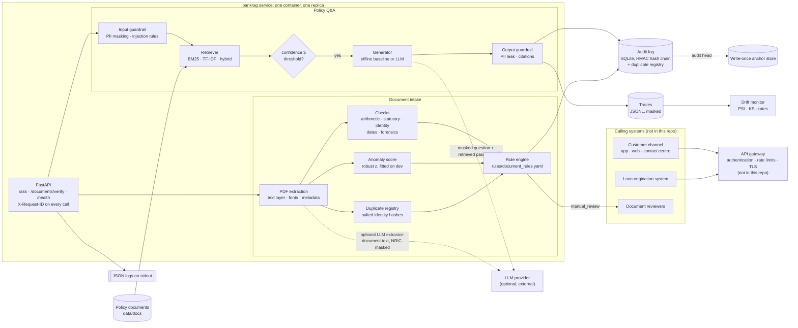
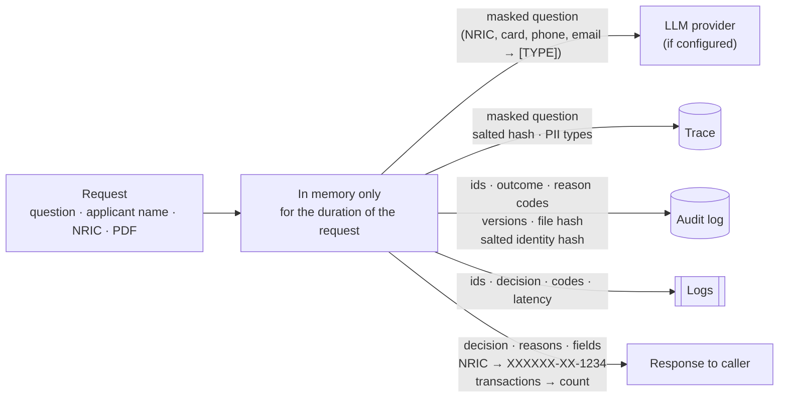
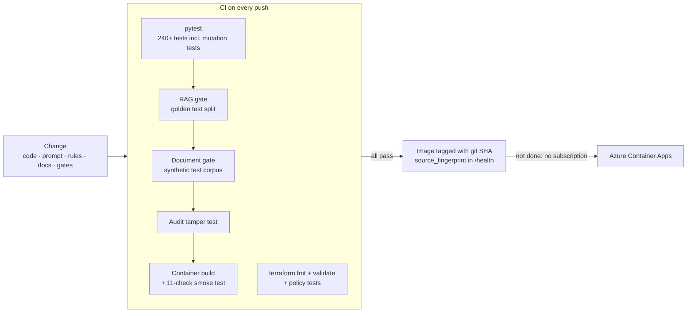

# Architecture

How the parts of `bankrag` fit together, where personal data goes, and how a change reaches production.
For the API contract, see [INTEGRATION_SPEC.md](INTEGRATION_SPEC.md). For the reasoning behind each
choice, see [DESIGN_DECISIONS.md](DESIGN_DECISIONS.md).

## System

**Two automations, one service.** Both answer through the same API, and both follow the same rules:
1. every decision carries a reason code
2. every decision is recorded in the audit log before the response is returned
3. anything the service cannot check goes to a person, not to an error

**What sits outside the repo:**
- **The API gateway.** It does authentication and rate limiting; the service has no auth of its own.
- **The callers**, including the reviewer workflow that receives `manual_review` documents.
- **A real LLM.** The default generator is an offline extractive baseline, so nothing leaves the process unless a provider is configured.

**Single replica.** The audit log and duplicate registry are one SQLite file with one writer. Scaling out
means moving them to Postgres first (ADR-009, [infra/azure/README.md](../infra/azure/README.md#known-gaps)).

## Personal data flow

The design principle: personal data is used where a decision needs it, then reduced to a mask, a count
or a salted hash before anything is written down.

| data | where it goes | how it's stored | how it's checked |
|---|---|---|---|
| Question text | memory; masked copy to the generator | trace: PII-masked text + salted HMAC hash. Logs and audit: not at all | PII leak gate = 0 on the golden set; `test_pii_never_reaches_response_logs_or_trace` |
| NRIC, card, phone or email in a question | replaced by `[NRIC]`, `[CARD]` and so on before retrieval | trace keeps only the *types* found | same tests; Luhn and NRIC date checks avoid masking random numbers |
| Names or addresses in a question | **not detected**: pattern-based masking misses them | they stay in the masked trace text | known limitation (model card L5). Traces need access control and retention limits |
| Applicant name, NRIC (application) | memory, for the identity check | registry: salted hash of the NRIC, or of the sorted name tokens when there's no NRIC | audit demo scans the database file: 0 names or NRICs found in 384 events |
| The PDF | memory only; never written to disk | audit: its SHA-256 | container smoke test checks the audit database for raw NRICs |
| Extracted fields (name, employer, amounts) | the response to the caller, NRIC masked | not stored. Registry keys are a truncated, *unsalted* SHA-256 of employer, staff number, period and two amounts (bank, account number, period and balances for a statement) | the key reveals nothing on its own, but someone holding the same document could confirm it was submitted. A salted or keyed fingerprint is the fix |
| Document text, with the optional LLM extractor | sent to the provider with the NRIC masked. Names and amounts are sent | not stored by `bankrag` | off by default; the provider's data terms apply |

**Secrets.** `BANKRAG_TRACE_SALT` (trace and identity hashes) and `BANKRAG_AUDIT_KEY` (audit chain) come
from the environment, which is Key Vault in the Azure design. The development key and salt each trigger a
warning at start-up. Rotating the trace salt breaks repeat-question and duplicate-applicant matching across the
rotation. Rotating the audit key needs a signed "key rotated" event, which isn't implemented.

## From change to production

`source_fingerprint` hashes everything that can change a result: code, config, prompts, rules, policy
documents, golden set, gates and the anomaly model. The eval reports, `/health` and the change record all
carry it, so a running container can be matched to the evidence it was approved on.
